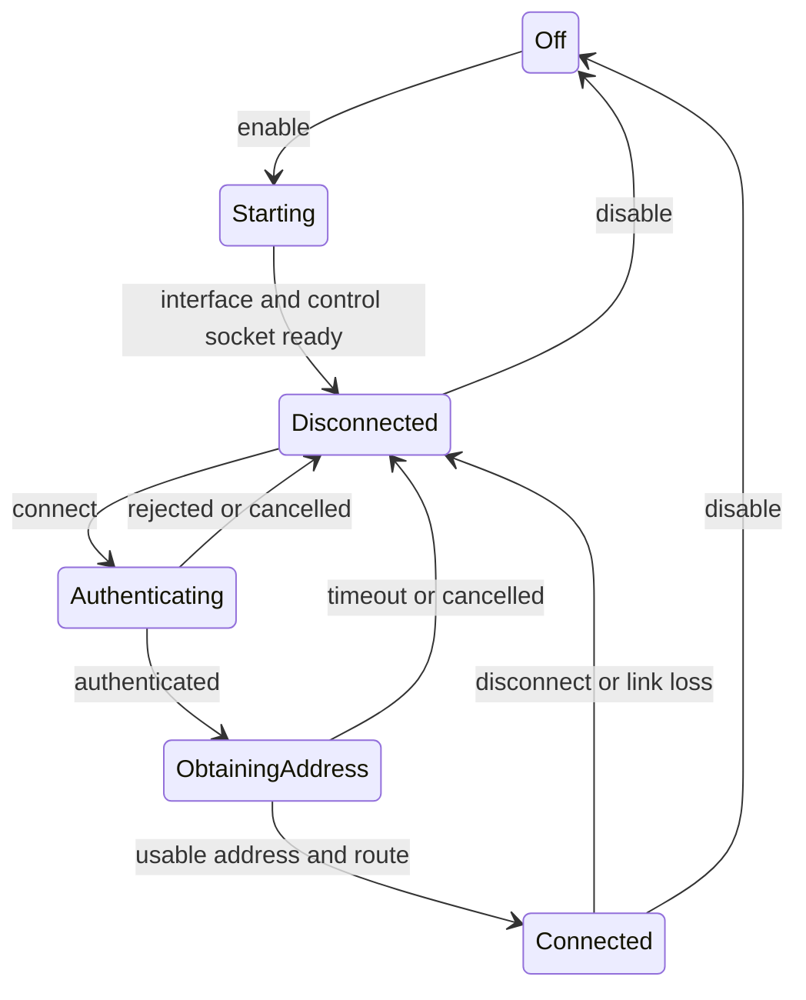

# Kobo Wi-Fi controls investigation

2026-09-07. This document records the implementation design. An initial subset
is now implemented; see [implementation status](kobo-wifi-implementation.md)
for available controls, validation, and remaining work.

## Conclusion

Implement Wi-Fi through one backend-owned service: model-specific radio power,
a supplicant client, and DHCP lifecycle management. Start with a switch and
reconnecting networks already configured on the Kobo, then add scan/join/forget.
Expose device controls through a new Kobo-only top bar above the existing
browser UI, as requested by the user. Wi-Fi and Bluetooth buttons in this bar
open their respective control popups.

Plato supplies a useful hardware reference, but directly wiring its scripts to
a switch would give unreliable state and block execution during connection.
The actual Libra 2 firmware still needs inspection. No Kobo was visible in the
local USB inventory, and no SSH address was supplied during this investigation.
Neither the active Wi-Fi driver nor the running network-service versions have
been verified on this device.

## Findings from the local code

Reference: Plato commit `922412057a194752a0df0dd325a8433f44c26333`.

| Finding | Consequence for Bokheim |
| --- | --- |
| [Plato enable script](../reference/plato/scripts/wifi-enable.sh) depends on `PLATFORM`, `INTERFACE`, and `WIFI_MODULE` | Capture and validate hardware hints before stopping Nickel; do not assume `wlan0`. |
| Power differs between `sdio_wifi_pwr`, `/dev/ntx_io` request 208, and MediaTek WMT | Select a driver adapter from observed firmware, including dependency modules and regulatory parameters. |
| Enable returns failure if a non-WMT module is already loaded | Reconcile partial states; “already loaded” should not automatically fail an enable request. |
| Interface discovery waits about four seconds but proceeds even when discovery fails | Each transition needs a verified result and deadline. |
| The script checks for any supplicant PID before starting one | Check the intended interface's control socket, not just a process name. |
| [Disable script](../reference/plato/scripts/wifi-disable.sh) uses broad `killall`, terminates supplicant and unloads modules | Explicitly manage process/interface ownership and avoid disrupting unrelated interfaces. |
| [`set_wifi`](../reference/plato/crates/plato/src/app.rs) changes desired state before calling scripts and ignores their status | Keep desired and observed state separate; surface actionable errors. |
| Plato listens for `network bound` in its device event stream | Authentication alone is insufficient; independently observe IP configuration. |
| Plato disables Wi-Fi before suspend and restores it after wake | Coordinate radio work with suspend rather than leaving connection tasks running across sleep. |

Bokheim's [launcher](../apps/desktop-gpui/kobo/run.sh) stops Nickel, but neither
captures its network environment nor explicitly manages DHCP. It also restarts
Nickel on exit. The service therefore needs a deliberate handoff in both
directions. An inherited working connection should initially be observed and
adopted rather than unnecessarily torn down at launch.

The existing brightness API uses the native backend's synchronous ordered queue.
Do not put shell waits, scanning or DHCP in that queue: they would hold up other
backend jobs. A dedicated device worker can serialize radio transitions while
the application worker awaits replies asynchronously. Merely wrapping blocking
code in `async` does not make it nonblocking.

## Connection protocol

The [supplicant control protocol](https://w1.fi/wpa_supplicant/devel/ctrl_iface_page.html)
supports Unix sockets. Use separate request and event connections, attaching
the latter before issuing operations. Relevant operations are:

| User action | Protocol |
| --- | --- |
| Read connection state | `STATUS` |
| Refresh available networks | `SCAN`, await scan event, then `SCAN_RESULTS` or per-entry `BSS` |
| List configured networks | `LIST_NETWORKS` |
| Join a new network | `ADD_NETWORK`, configure via `SET_NETWORK`, then enable/select |
| Disconnect / reconnect | `DISCONNECT` / `RECONNECT` |
| Forget a configuration | `REMOVE_NETWORK` |

`SELECT_NETWORK` disables other configurations, so record the prior enabled set
for cancellation. Command acceptance is not operation completion. Read status
after attachment to close event races. Use per-BSS retrieval when scan results
exceed a response buffer.

[KOReader's Kobo backend](https://raw.githubusercontent.com/koreader/koreader/master/frontend/device/kobo/device.lua)
also uses an interface-specific supplicant socket and separate IP acquisition.
Its [WPA helper](https://raw.githubusercontent.com/koreader/koreader/master/frontend/ui/network/wpa_supplicant.lua)
shows SSID decoding, hexadecimal SSID configuration, WPA PSK derivation, and
removing a newly created configuration on failure. Treat SSIDs as bytes for
identity; display text is not a reliable identifier. Pass credentials through
the socket, never through shell command interpolation or logs.

## Proposed backend API and lifecycle

Suggested operations: `wifi_status`, `wifi_changes`, `set_wifi_enabled`,
`scan_wifi`, `connect_saved_wifi`, `join_wifi`, `disconnect_wifi`, `forget_wifi`,
and `cancel_wifi_operation`.

Use a service-owned operation ID for cancellation and stale-response handling.
Return typed errors for unavailable hardware, initialization failure, rejected
credentials, authentication timeout, and IP configuration failure. Define
configurable deadlines for commands, scanning, authentication, and DHCP; tune
them against the device instead of assuming desktop timings.



Scanning is a separate activity flag: it can occur while connected. “Connected”
means a usable local network configuration, not proof of internet access.
Internet/server reachability belongs in a separate status so captive portals
and unavailable Bokheim services are not misreported as Wi-Fi authentication
failures. Ignore late events from a cancelled operation or pre-suspend session.

On suspend: cancel scan/join, stop owned DHCP work, remember desired Wi-Fi state,
and complete radio shutdown before kernel suspend. On wake: rediscover state
and reconnect only if Wi-Fi was desired. A failed suspend must also restore the
previous operational state. On exit: stop app-owned tasks and hand ownership
back before Nickel restarts. Do not unload shared radio hardware underneath
Bluetooth; the selected adapter must describe shared dependencies.

## Credentials and compatibility

For the first implementation, reuse existing configured networks without
rewriting firmware settings. Connecting to a saved network needs no password
entry. Joining new networks should initially support open and WPA2-Personal;
report other modes explicitly until device capabilities have been tested.
WPA3 and enterprise authentication need capability checks and their own flows.

Before adding persistence, verify how the firmware writes its supplicant
configuration. Choose one owner. A Bokheim-owned file can be restricted to the
device and updated atomically, but then sharing saved networks with Nickel
becomes a separate feature. Do not automatically save the whole live firmware
configuration after each temporary join. Never include Wi-Fi secrets in library
sync or diagnostic reports. Failed joins should remove only their own temporary
configuration and restore the previous selection where possible.

## Kobo device top bar

User requirement: add a separate, Kobo-only top bar above the current browser
UI. Wi-Fi, Bluetooth, and other device controls belong in this bar, rather than
the browser's settings section or its existing toolbar.

Compose a `KoboDeviceBar` above `BrowserRoot` in the browser branch of
[`ApplicationRoot`](../apps/application-shell/src/lib.rs), gated by the `kobo`
feature. Use a vertical layout with a fixed-height device bar and a flexible
browser area below it. Reserve actual layout space so the bar does not cover
browser content. Keep it visible across browser routes, including settings.
Reader mode keeps its existing brightness button; the new bar is scoped to
the browser surface.

Give the bar the application backend connection and one application-owned
status subscription. Reopening a popup must not create another radio manager.
The Wi-Fi status button anchors a popup below the bar with these controls:

1. Wi-Fi switch, observed state, and connected network summary. Show “Turning
   on…” or “Turning off…” while a power transition is pending.
2. Saved networks first, followed by nearby networks with signal and security.
   Refresh starts a bounded scan; do not continually scan while reading.
3. Selecting a secured network opens a password dialog with show/hide, Connect,
   and Cancel. Hidden-network entry needs both name and security selection.
4. Show authentication and address acquisition separately, with Cancel and
   specific retry guidance. Expose Disconnect separately from Forget.
5. Reflect connected, disconnected, and pending states on the bar's Wi-Fi
   button even while the popup is closed. Closing the popup stops discovery
   work owned by that popup, while connection state remains application-owned.

The current GPUI Kobo shell already wraps content in `KoboKeyboardRoot`
(`GPUI-Fork/crates/gpui_kobo/src/virtual_keyboard.rs`), so the password field can
use the existing text-input mechanism. Verify that the dialog stays visible
above that keyboard in both orientations. Network-list updates should preserve
focus/selection; display-name collisions must not merge different security modes.

## Device inspection and validation

Run the read-only [inventory script](../apps/desktop-gpui/kobo/inspect-wifi.sh)
on the Kobo, once under Nickel and once during Bokheim:

```sh
sh inspect-wifi.sh
```

It lists selected hardware hints, utility versions/availability, process IDs,
interface drivers/state, control sockets, and firmware-hook existence. When a
timeout utility is available, it sends only a bounded supplicant `PING`. It does
not scan, change power, join networks, or read credential files. No device run
has been performed; shell syntax has been checked locally.

Then validate in this order: preserve an inherited connection; enable from off;
reconnect a saved network; wrong-password and DHCP-timeout handling; cancellation
and rapid toggles; punctuation/non-UTF-8 SSIDs and duplicate access points;
sleep/wake and failed suspend; finally exit to Nickel. Use a fake supplicant
socket to test interleaved events, malformed/truncated responses, daemon loss,
and late completion without requiring hardware for every regression test.
